

  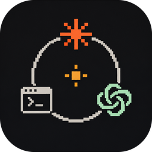
  <h1>Terax2</h1>
  
여러 Claude 세션을 함께 실행하고 지휘하는 Windows 터미널

  
<a href="https://github.com/crynta/terax-ai">crynta/terax-ai</a> 기반 개인 빌드

## 설치

1. [최신 릴리즈](../../releases/latest)에서 `Terax_<버전>_x64-setup.exe`를 받아 실행
2. 이후 업데이트는 앱이 알려 줌. 설정 → 정보에서 업데이트하거나 이전 릴리즈로 되돌리기 가능

## 화면

| | |
|---|---|
| 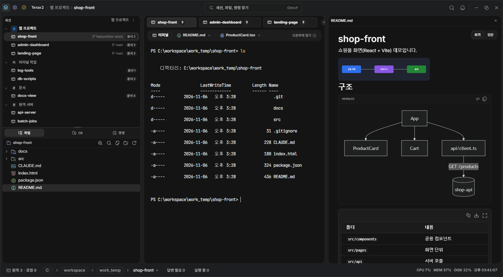 워크스페이스 목록 · 터미널 · 문서 패널 | 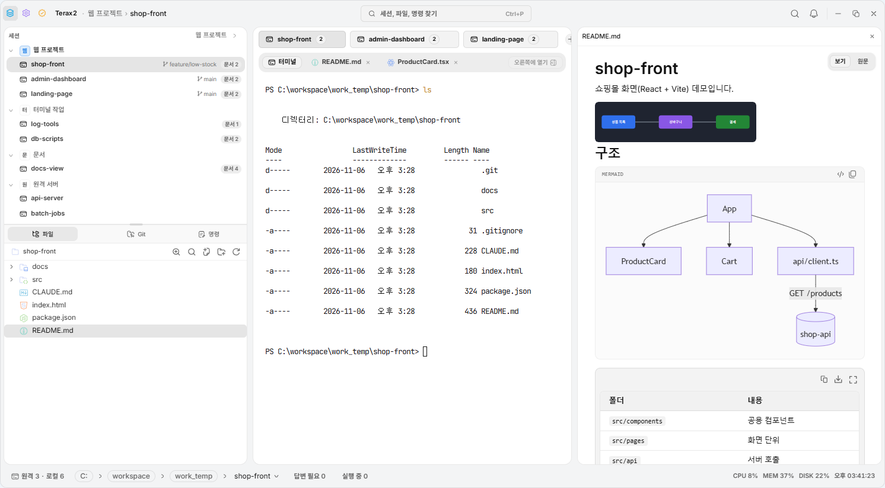 DevTheme 라이트 |
| 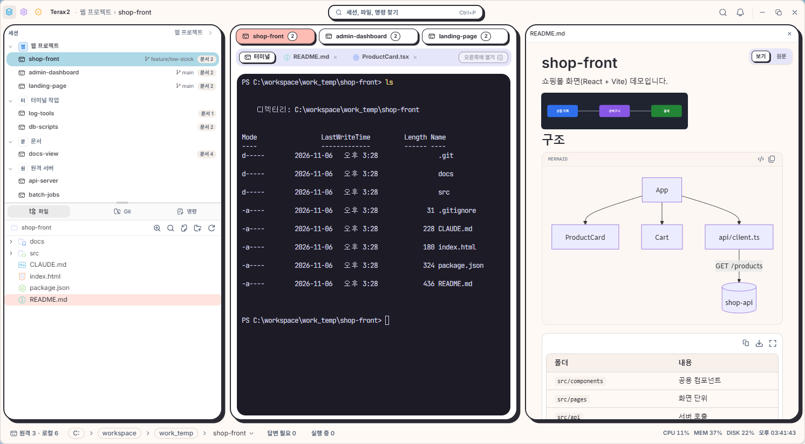 ClayTheme 라이트 | 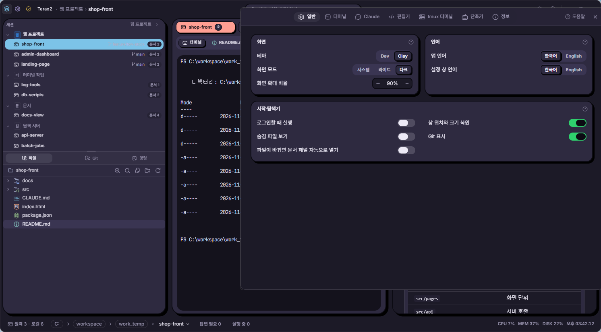 설정 |
| 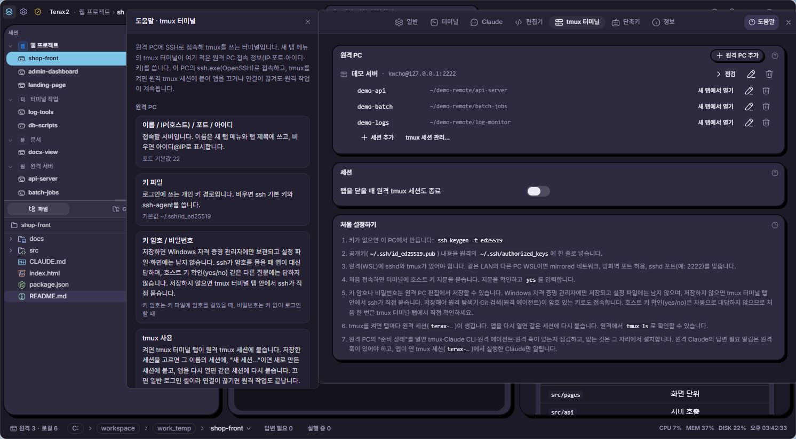 tmux 터미널 설정과 도움말 | 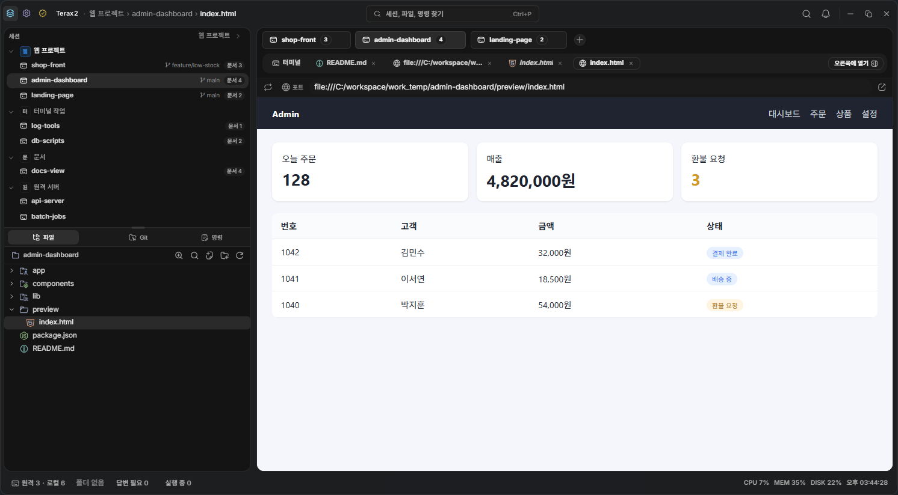 로컬 HTML 미리보기 |
| 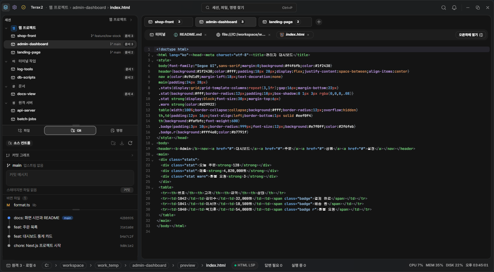 편집기 · Git 탭 | 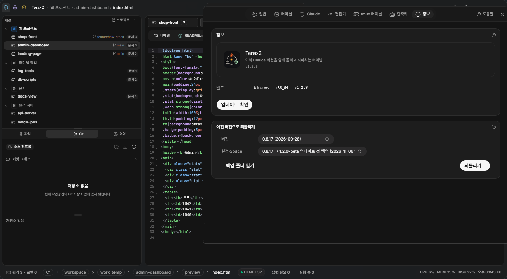 이전 버전으로 되돌리기 |

## 핵심 기능

| | | |
|---|---|---|
| **🗂️ 워크스페이스 목록** 폴더별 터미널과 문서를 그룹으로 묶어 한 목록에서 관리 | **🔔 답변 필요 알림** Claude가 질문하면 바로 알리고 대기 시간 표시 | **🤝 Claude 협업** `terax send/ask`로 탭끼리 지시를 주고받음 |
| **📄 문서 패널** 마크다운·mermaid·HTML을 터미널 옆에서 미리 보기 | **🌿 파일·Git** 탐색기, 내용 검색, 커밋과 그래프를 한 곳에서 | **🖥️ 원격 tmux** SSH로 원격 PC에 연결, 앱을 꺼도 작업 유지 |
| **💾 워크스페이스 유지** 터미널을 닫거나 앱을 다시 켜도 워크스페이스와 문서가 그대로 | **🎨 테마** DevTheme·ClayTheme, 라이트·다크, 터미널 색 구성표 15종 | **🔄 안전한 업데이트** 한 릴리즈씩 업데이트, 언제든 이전 릴리즈로 되돌리기 |
| **📑 Office·HWP 보기** docx·xlsx·pptx·hwp·hwpx를 앱 안에서 읽기 전용으로 열기 | **🖼️ 이미지·PDF·영상** 확대·축소와 이동, 원격 PC의 파일도 그대로 열기 | **🛠️ 문서 도구** 확대·쪽 이동·인쇄, 다른 이름으로 저장 |

## project-templates와 함께 쓰기

[project-templates](https://github.com/kwchodev/project-templates)는 프로젝트 지식을 `pjt-docs/`에, 작업 이어받기 기록을 `.baton/`에 두는 지식관리 표준.

- Claude가 작업을 시작할 때 진행 중인 일과 결정 문서를 먼저 읽고 이어서 작업
- 워크스페이스마다 Claude를 띄워 두면 프로젝트별 맥락이 끊기지 않아 작업 효율 향상

## Claude 협업

여러 탭에서 Claude Code를 함께 돌릴 때 질문을 놓치지 않고 한 곳에서 지휘하기 위한 기능.

1. **답변 필요 알림:** Claude가 질문하면 워크스페이스 목록, 상태 표시줄, Windows 알림으로 알림. 얼마나 기다렸는지도 표시
2. **기다리는 곳으로 바로 이동:** `Ctrl+Shift+A`로 가장 오래 기다린 워크스페이스부터 차례로 이동. `Ctrl+Shift+L`로 에이전트 목록 열기
3. **탭끼리 지시:** Claude가 `terax send <탭> "지시"`로 다른 탭의 Claude에게 일을 맡기고, `terax ask`로 답을 받고, `terax read`로 그 탭 화면을 읽음. 받는 탭은 바로 작업을 시작하고 사용자는 그 화면을 지켜볼 수 있음
4. **서브에이전트 표시:** 백그라운드에서 실행 중인 작업을 그 탭 아래에 표시
5. **대화 재개:** 앱을 다시 켜면 Claude 대화가 있던 탭에서 `claude --resume`으로 이어 가기(기본 꺼짐)
6. **설치 동의:** Claude 설정에 훅과 안내 블록을 넣기 전에 먼저 동의 확인

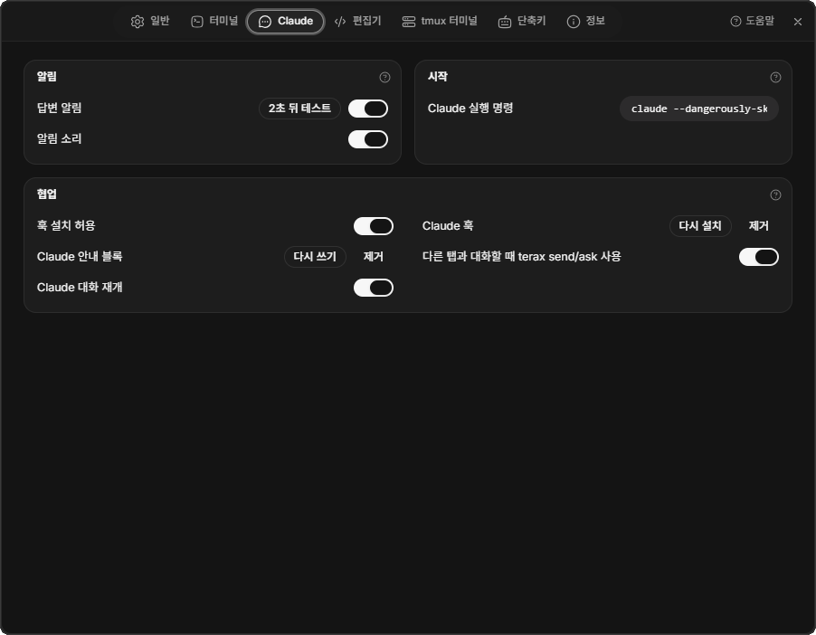

### 활용도

여러 프로젝트·브랜치에서 Claude Code를 병렬로 돌릴 때 특히 유용.

**자주 쓰는 기능 (병렬 작업의 병목 해소)**

- **답변 필요 알림과 대기 시간:** Claude를 3~4개 이상 띄우면 어느 탭이 승인·질문 대기로 멈췄는지 놓치기 쉬움. 대기 시간까지 보이므로 우선순위를 정해 바로 개입 가능
- **단축키 이동(`Ctrl+Shift+A`, `Ctrl+Shift+L`):** 탭을 하나씩 눌러 상태를 확인하는 전환 비용 제거. 병렬 작업에서 가장 자주 쓰는 기능
- **서브에이전트 표시:** 탭이 멈춘 것인지 백그라운드에서 일하는 중인지 바로 구분

**여러 프로젝트를 나눠 맡길 때 쓰는 기능**

- **탭끼리 지시(`terax send/ask/read`):** 프론트엔드·백엔드·인프라를 탭별 Claude가 나눠 맡는 구성에서 유용
  - 예: 백엔드 탭 Claude가 API 스펙을 고친 뒤 프론트엔드 탭 Claude에게 `terax send`로 타입 정의와 호출부 수정을 지시. 사용자는 그 과정을 화면으로 확인
  - 주의: 에이전트끼리 자동으로 일을 넘기면 의도하지 않은 수정이나 토큰 소모로 이어질 수 있음. 처음에는 `read`나 한 번짜리 `send` 위주로 통제하며 사용

**흐름 예시**

1. backend 탭 Claude가 `terax ask`로 frontend 탭에 수정 요청. 알림으로 보낸 내용 표시

   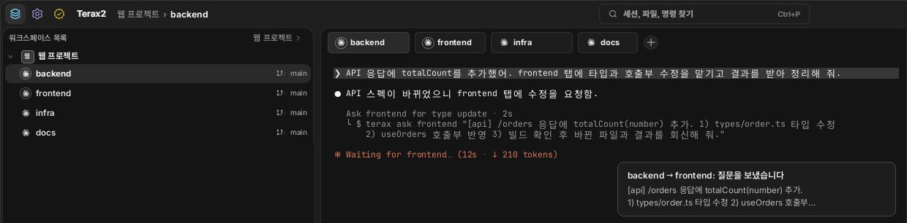

2. frontend 탭 Claude가 요청을 받아 바로 작업하고 `terax send`로 결과 회신

   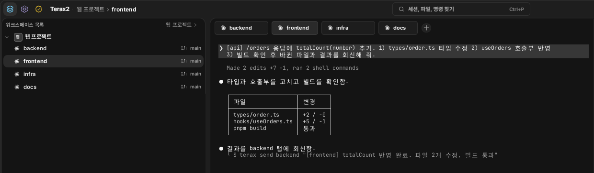

3. backend 탭 Claude가 회신을 받아 정리

   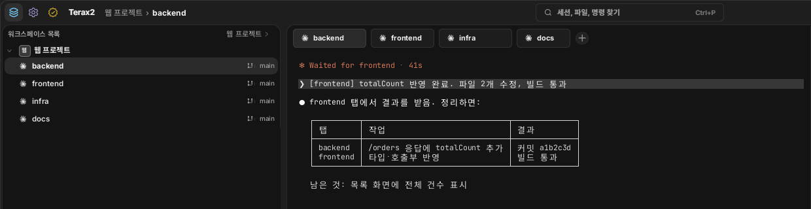

**안전장치**

- 훅은 동의를 받은 뒤에만 Claude 설정에 설치
- 토큰을 쓰는 `--resume` 대화 재개는 기본 꺼짐

## tmux 터미널 (원격 PC)

원격 PC에서 Claude를 돌리고, 앱을 끄거나 연결이 끊겨도 작업이 계속되게 하기 위한 기능.

> **안내:** 개인 환경(WSL·원격 Linux + tmux)에 맞춰 만든 기능. 다양한 환경에서 범용 테스트는 하지 않았음.

1. **끊겨도 유지:** 새 탭 메뉴의 "tmux 터미널"이 `ssh.exe`로 원격 PC에 접속해 tmux 세션에 연결. 앱을 꺼도 원격 작업은 계속되고, 다시 켜면 같은 세션에 다시 연결
2. **세션 저장과 관리:** PC마다 tmux 세션 여러 개를 이름과 시작 폴더로 저장. 연결된 탭과 시간을 보고 세션 바꾸기, 이름 바꾸기, 강제 종료
3. **원격도 로컬처럼:** 원격 에이전트가 파일 탭, Git 탭, 검색을 원격 tmux 폴더에 맞춤. 원격 브랜치와 원격 PC의 CPU·MEM·DISK도 표시
4. **파일 주고받기:** 업로드, 다운로드, 드래그 앤 드롭, 클립보드 붙여넣기. 진행률 표시, 중간 취소 가능
5. **원격 Claude 알림:** 원격 PC의 Claude가 질문해도 로컬과 똑같이 "답변 필요"로 알림
6. **준비 상태 점검:** tmux, Claude CLI, 원격 에이전트, 원격 훅을 점검하고 없는 항목은 그 자리에서 설치
7. **안전한 보관:** 패스프레이즈와 비밀번호는 Windows 자격 증명 관리자에 보관
8. **원격 이미지·PDF·영상 보기:** 원격 PC의 파일을 앱 캐시로 받아 로컬 파일처럼 열기. 원격 크기·수정 시각이 같으면 받은 파일을 다시 사용(200 MB 초과는 받지 않음)
9. **원격 파일 캐시 정리:** 앱을 켤 때 10일 넘게 안 쓴 사본을 지우고, 합계가 1 GB를 넘으면 오래된 것부터 지움. 설정 → tmux 터미널의 "원격 파일 캐시"에서 사용량을 보고 비우기 가능
10. **원격 훅 업데이트 확인:** 설치된 원격 훅이 옛 버전이면 원격 PC를 고를 때 "원격 훅을 업데이트할까요?"를 물음. 확인해야 원격 `~/.claude/settings.json`을 고치고 원본은 백업. 처음 설치는 설정의 버튼으로만 진행

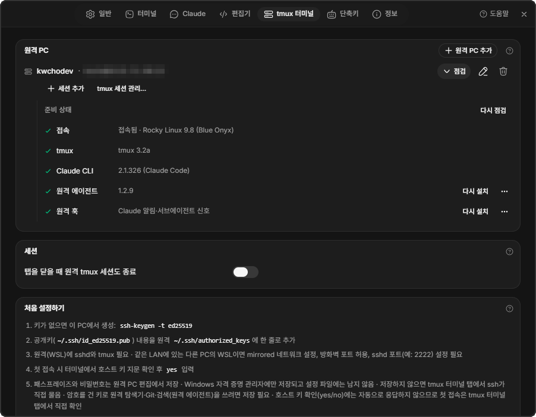

## 전체 기능

### 화면 배치

- **제목 표시줄:** 왼쪽에 패널·설정·새로운 기능 버튼, 가운데에 `Ctrl+P` 통합 검색, 지금 위치(그룹 › 워크스페이스 › 문서)와 업데이트 버튼 표시
- **탭 두 줄:** 1줄은 터미널 탭, 2줄은 그 워크스페이스에 딸린 문서 탭
- **문서 패널:** 오른쪽에서 문서를 보기·원문으로 전환하고, 파일 변경 사항도 확인
- **상태 표시줄:** 브랜치, 답변 필요 수, 실행 중 수, 로컬·원격 PC의 CPU·MEM·DISK(사용률별 색), 시각, 앱 버전

### 워크스페이스 목록

- 워크스페이스(터미널 탭 1개 + 문서 탭)를 그룹으로 묶어 모든 그룹을 한 목록에 표시
- 행마다 Claude 실행 표시, 답변 대기 시간, 브랜치, 문서 수
- 워크스페이스를 다른 그룹으로 옮기기, 목록에서 삭제
- 워크스페이스 구성을 `.terax/workspace.json`으로 내보내기·가져오기(가져올 때 명령 내용 확인)

### 워크스페이스 유지

- 터미널을 닫아도 워크스페이스와 문서는 목록에 흐리게 남고, 누르면 같은 폴더에서 다시 시작
- 앱을 다시 켜면 탭과 문서를 그대로 복원
- 업데이트한 뒤에도 마지막으로 보던 탭 유지

### 터미널

- xterm.js + WebGL 렌더링
- PowerShell, cmd, WSL, bash, zsh, fish 지원. 그룹마다 Windows 또는 WSL 환경 선택
- 명령 단위로 출력을 나눠 보는 블록 모드
- 워크스페이스마다 이름과 시작 폴더 지정
- 터미널 출력에 나온 파일 경로를 눌러 열거나 탐색기에서 위치 표시
- 클립보드 이미지를 파일로 저장해 경로 붙여넣기(WSL·SSH 포함)
- 파일을 드래그 앤 드롭하면 셸에 맞게 따옴표 친 경로 입력
- 빠른 한글 입력에서 받침이 넘어가거나 글자가 빠지는 문제 보정

### 탭

- 드래그로 순서 바꾸기, 이름 바꾸기
- 다른 탭 닫기, 오른쪽 탭 닫기, 실행 중인 프로세스가 있으면 닫기 전 확인
- 탭이 넘치면 양 끝에 좌우 이동 버튼 표시
- 닫은 터미널 탭을 상단 탭 줄에서 숨기는 옵션
- Claude가 일하는 동안 탭 아이콘에 회전 링 표시

### 파일 탐색기

- 고른 워크스페이스의 터미널 폴더 기준(저장소 하위 폴더도 그 폴더 그대로)
- 파일 이름 퍼지 검색, 파일 내용 검색(대소문자·단어·정규식)
- 이름 바꾸기, 여러 개 선택해 이동·삭제
- OS 클립보드의 파일 붙여넣기, 바깥 파일 드래그 앤 드롭
- Git 상태를 파일 색으로 표시, 숨김 파일 보기 전환

### Git

- 변경 파일 목록, 스테이지, 커밋 메시지 입력과 커밋
- 푸시, 풀, 브랜치 표시
- 컴팩트 커밋 그래프와 커밋별 차이 보기
- 저장소 루트를 자동으로 찾아 하위 폴더에서도 같은 저장소 표시

### 편집기

- CodeMirror 6 기반
- 언어 서버(LSP) 연결. C#(`csharp-ls`), Java(`jdtls`), HTML 등
- XAML 구문 강조
- Vim 모드, 줄 바꿈 열 지정
- 이미지·영상·PDF 보기([이미지·PDF·영상](#이미지pdf영상) 참고)

### 마크다운

- 파일이 바뀌면 보던 위치 그대로 자동 새로고침
- 상대 경로 이미지 표시
- mermaid 다이어그램(테마 연동, 소스 보기, 오류 표시)
- 문서 안 찾기, 문서 안 파일 링크 눌러 열기
- 문서 안 이미지를 누르면 확대 보기
- 보기↔원문 전환 시 위치 유지, 글꼴 지정

### 이미지·PDF·영상

- 이미지는 창에 맞춰 표시. `Ctrl`+휠이나 오른쪽 위 버튼으로 확대·축소, 두 번 누르면 맞춤과 100% 전환, 확대하면 끌어서 이동
- 오른쪽 패널에서도 이미지·PDF·영상을 파일 그대로 열기
- tmux 터미널의 원격 파일도 같은 방식으로 열기

### 문서 뷰어(Office·HWP)

- docx·xlsx·pptx·hwp·hwpx를 읽기 전용으로 열기. 뷰어는 본체에 넣지 않고 처음 열 때 다운로드해 설치하는 플러그인
- 설정 → 정보의 "뷰어 플러그인"에서 설치·삭제·업데이트, zip 파일로도 설치 가능
- 확대·축소·너비 맞춤, 쪽·시트·슬라이드 이동, 인쇄(PDF는 Windows "Microsoft Print to PDF"로 저장)
- 문서 탭 줄의 "다른 이름으로 저장"으로 같은 형식의 사본 저장(로컬 문서만). 편집과 덮어쓰기 저장은 없음

### 웹 미리보기

- 로컬 HTML 파일 열기(경로, `file://`, 탐색기 우클릭). 폴더 단위로 서빙해 localStorage도 동작
- 외부 URL 열기, 외부 브라우저로 열기

### 저장한 명령

- 자주 쓰는 명령을 그룹, 설명과 함께 저장(여러 줄 명령 가능)
- 누르면 지금 탭에 입력, ▶를 누르면 입력하고 바로 실행
- 모든 그룹에서 공용

### 테마

- DevTheme(평평한 패널, 기본), ClayTheme(굵은 테두리 카드)
- 시스템·라이트·다크 화면 모드
- 배경 이미지, 투명도, 흐림, Mica(DevTheme)
- 화면 테마와 별도로 고르는 터미널 색 구성표 15종
- 화면 확대 비율 조절

### 설정

- 7개 섹션: 일반, 터미널, Claude, 편집기, tmux 터미널, 단축키, 정보
- 항목마다 설명·기본값을 보여 주는 도움말 창
- 터미널·마크다운 글꼴 이름 직접 입력(JetBrains Mono, Inter, Nerd Font 기호 내장)
- 한국어·English, 앱 언어와 설정 창 언어 따로 지정

### 단축키

- `Ctrl+P` 워크스페이스·파일·명령 통합 검색
- `Ctrl+Alt+]` `[` 워크스페이스 이동, `Ctrl+Alt+\` 문서 탭 순환
- 앱을 새로고침하는 브라우저 단축키(F5, Ctrl+R) 차단

### 업데이트

- 시작할 때 새 릴리즈를 확인해 제목 표시줄에 업데이트 버튼 표시
- 한 릴리즈씩 차례로 업데이트, 버전 선택, 1·7·14일 중 골라 미루기
- "새로운 기능" 창에서 릴리즈별 기능과 수정 이력 확인
- 이전 릴리즈로 되돌리기(설정 백업 복원 선택)
- 버전이 바뀔 때 설정 자동 백업, 정보 화면에서 골라 삭제

### 안정성

- WebView2가 멈추면 복구 대화상자 표시
- 창 위치와 크기 복원
- 로그인할 때 자동 실행

## 라이선스

Apache-2.0 (원본과 같음)
